# Models made in Blender: experiments and how to plan around them

**Status: look-dev only.** None of this is in the game yet. The model lab places the models in Monteforchetta for
screenshots; you can walk straight through them. Made on 2026-11-07 to answer whether hand-built models are worth
switching to, and what switching would involve.

## What was made
All built in Blender 4.2 LTS by Python scripts in `tools/blender/`, exported as glTF (`godot/assets/models/lab/`),
and placed by the model lab along the road from the lay-by into the piazza.

| Model | What it shows | Triangles | File |
| --- | --- | --- | --- |
| `casa_ocra` | Two storeys: arched door with fanlight, balcony with geraniums, house number, wall lamp, pots by the door | 27,920 | 2.0 MB |
| `tabaccheria` | Three storeys: a tobacconist's front ("SALI E TABACCHI", the blue T sign, striped awning), a faded painted advert high on the side wall | 39,108 | 2.8 MB |
| `casa_crema` | Two storeys: plain door, plaster fallen off in patches showing the brick, a bench | 23,372 | 1.4 MB |
| `casa_gialla` | Three storeys with small attic windows, a painted sundial dated MCMXCIX, a balcony | 36,164 | 2.7 MB |
| `via_selciato` | The street: river cobbles with two lines of stone slabs down the middle, as in Piedmont towns | 36,784 | 1.0 MB |
| `sindaco` | The Sindaco rigged and animated: 12 bones; idle, walk (a waddle) and talk (an orator's raised hand) | 3,612 | 0.2 MB |

Every house has a footing of layered sandstone, plaster walls that lean a little, curved coppi tiles laid one by one
with a sagging ridge, wide eaves on rafter tails, a copper gutter and downpipe, a chimney with its own little roof,
plaster bands between the floors, and louvred shutters left open, shut or ajar. The same houses are reused in other
colours on the far side of the street (`recolor` in the lab file).

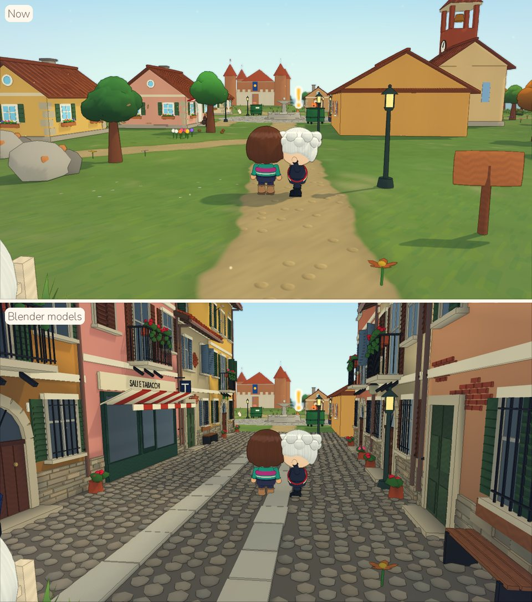

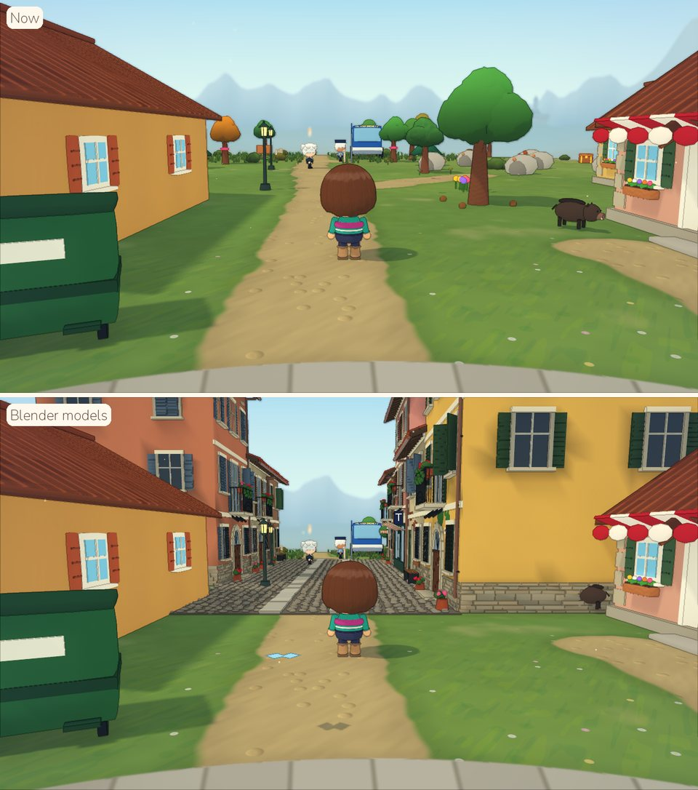

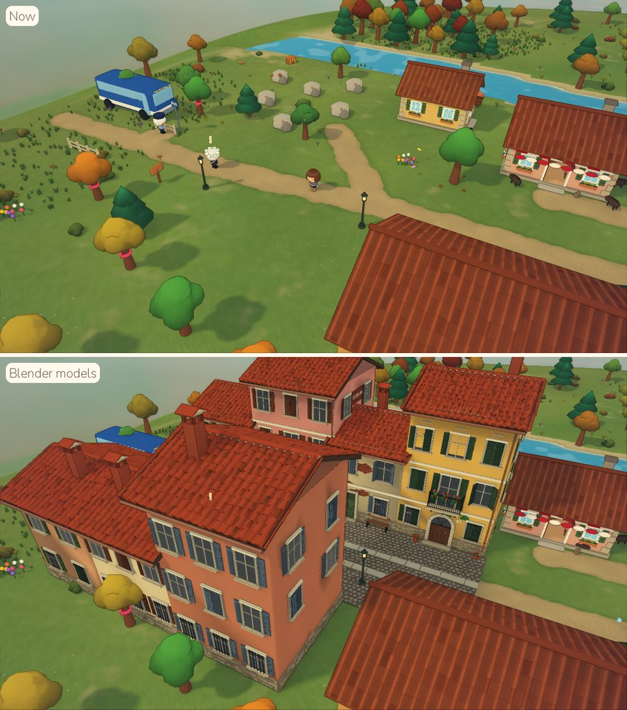

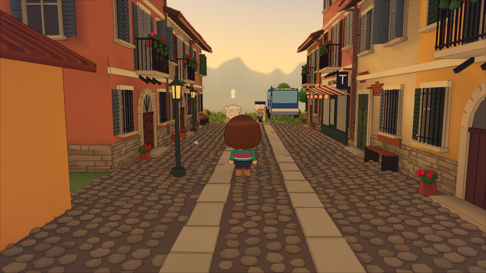

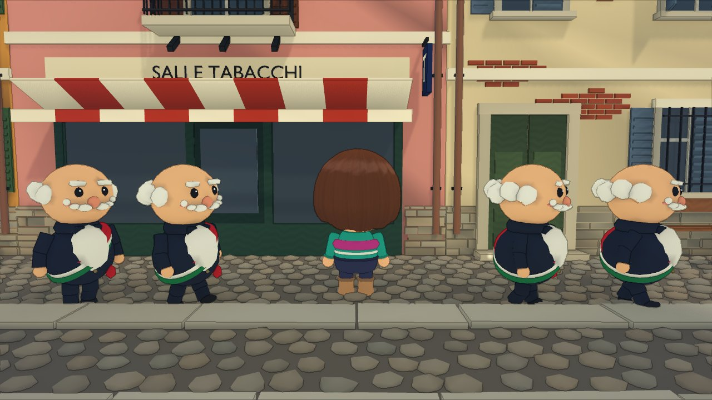

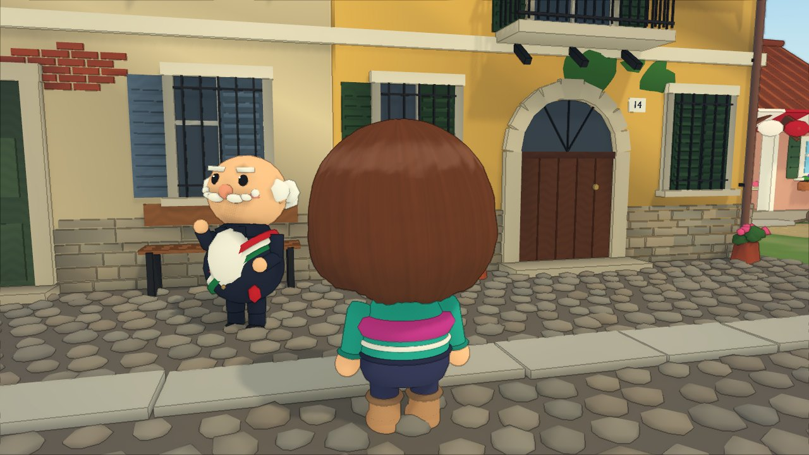

## What the experiments showed
Checked by eye in Forward+ screenshots (software Vulkan) and by `tests/test_models.gd`. **Not checked:** frame rate
on a real graphics card, and how the street feels to walk down, since the models have no collision yet.

1. **Local flair comes from details.** The walls are simple boxes. What makes the street read as Langhe and not
   "cozy village" is the coppi, the shutters, the sandstone footing, the iron balconies with geraniums, the
   tobacconist's T, the awning, the faded advert, the sundial, the slab tracks in the cobbles. Each is a small piece,
   modelled once and reused.
2. **Density matters as much as the models.** Attached houses of two and three storeys along a lane 7.5 m wide turn
   cottages on a lawn into a village. Monteforchetta has 9 buildings, with lawns between them. Converting it means
   relaying the village (layout data and the heightfield), not only swapping meshes.
3. **The two styles don't mix.** Next to the Blender street, the procedural workshop and bakery look like
   placeholders. Convert a whole location at a time: its buildings first, then the ground, then props.
4. **The game's look carries over.** `ModelKit` swaps each `wh_<kind>_<hex>` material for the game's own (`Palette`),
   so models get the same wrapped light, rim, painted detail, ink outlines, fog and grade as everything else. Ambient
   occlusion baked into vertex colours grounds them: dark under the eaves and balconies, in the window reveals and
   between the cobbles.
5. **Making them is quick; the decisions are what take time.** All six models rebuild in about 20 seconds, identical byte
   for byte each time. A new house is a line of parameters, plus code for any new kind of
   detail.
6. **They cost triangles and file size.** A house is 23,000 to 39,000 triangles and 1.4 to 2.8 MB. A village of 30
   houses would be around a million triangles. That's fine for a desktop card, and has to be measured on a laptop
   and a Steam Deck. Godot generates LODs for imported meshes by default, which should help; that wasn't measured.
7. **The character pipeline works, but characters show the limits of scripted modelling.** The rig and three
   animations go through glTF into Godot's `AnimationPlayer` and pose correctly, and the Sindaco's silhouette (round
   belly, short legs, bald head, handlebar moustache, sash) is instantly his. But:
   - each part follows one bone (rigid skinning), so the arms float at the shoulders;
   - the face is modelled, so it can't blink, change mood or talk like the chibis' face shader;
   - it doesn't use the wardrobe.

   Organic shapes and faces are where a character artist makes the difference.

## Decisions to make
1. **Who makes what.** Scripted modelling, as here, suits architecture and props: straight lines, repetition,
   regional details, palettes. Characters and a few hero props (the church, the castle, the fountain) gain most from
   a human artist. A mix works because the `.blend` files are shared: `--blend <dir>` saves them, and an artist can
   open any scripted model and carry on by hand.
2. **Characters.** Three ways to go:
   - **Keep the code-built chibis** and give villagers different bodies within that system: height, belly, leg
     length, shoulders. Cheapest, keeps the wardrobe and the face shader. Recommended now: it fixes the silhouette
     problem.
   - **Bespoke Blender villagers**, keeping the code-built chibi for the player only, because of the wardrobe.
   - **Everyone in Blender** on one shared skeleton, with clothes as swappable meshes and the face shader on a
     textured head. The way most studio games do it, and the most work.
3. **How buildings are stored.** Whole houses as `.glb` files are simple, but heavy: about 2 MB each, and a new copy
   in the git history every time one is rebuilt. Better for the real thing: export a **kit of parts** from Blender
   (window and shutter variants, doors, balconies, roof strips, chimneys, footing) and assemble each building in
   Godot from layout data, the way the rest of the game is built. Files stay small, repeated parts render as
   instances, and buildings stay data. If whole files are kept, use Git LFS.
4. **Scope.** Do it as the vertical slice: Monteforchetta's village first (relayout, buildings, paving), judged in
   play, before any other location gets models.

## Putting a Blender building in the game for real
What it would take, beyond the lab:
- **Layout:** a `"model"` key on a building in `layout.json`; `Village.build` loads it with `ModelKit` instead of
  `Props.cottage`. Collision and walking stay as they are, from the building's footprint in the layout (`WalkWorld`),
  so the model must match its `x`, `z`, `w` and `d`, which a test can check.
- **Rooms you can walk into:** the model's walls and doorway must match `Interiors` (wall thickness, door width and
  height), and its roof must be a separate node so it can fade. The lab joins each house into one mesh, so this
  needs a change in `kit.join`.
- **Night:** the glass material should join the village's window materials, so windows light up after dark like the
  current houses' do.
- **Snow:** Blender roof tiles use the plain mottle material, so they don't take the `world_snow` dusting the roof
  shader gives. They need a version of that shader without its painted tiles.
- **Camera:** buildings stop the camera through `Props.camera_blockers`; check the taller houses are covered.
- **Speed:** measure a full street on a low-end machine before converting a whole location.

## The house kit (conversion step three)
Buildings are stored as a **kit of parts** (decision 3 above), not as whole houses: whole houses were 1.4 to 2.8 MB
each, and most of that was the same windows, shutters and tiles repeated.
- **The kit:** `tools/blender/house_kit.py` builds every part with the same code as the lab houses (`langhe_lane.House`)
  and writes them all to `godot/assets/models/kit/langhe_kit.glb`: 233 KB and 3,432 triangles. The parts:
  - a window, an iron grate, and a shutter leaf shut, ajar (110 and 135 degrees) and open;
  - an arched door, an arched doorway with no leaf (for rooms you walk into), and a plain door;
  - a balcony with its French window and geraniums;
  - a shopfront, shut or with an open doorway;
  - a chimney stack and cap;
  - a coppo cap and pan;
  - a wall lamp and a pot of flowers.

  Rebuild it with `blender -b --factory-startup -P tools/blender/house_kit.py -- --out godot/assets/models/kit`.
- **The assembler:** `HouseKit` (`godot/scripts/world/house_kit.gd`) builds a house from its layout entry:
  - plaster walls to the footprint, the gable, floor bands and the cornice;
  - a sandstone footing laid stone by stone, quoins if the place's house style has them;
  - bays of windows on every floor, each with its shutters in a random position (seeded, so a house is the same
    every time);
  - the door or shopfront, a balcony, a wall lamp and pots;
  - coppi laid tile by tile with a sagging ridge, rafter tails, a gutter, a downpipe and a chimney.

  Repeated parts are drawn as instances, so a house is 20 to 27 draw batches and 13,000 to 24,000 triangles.
- **In the layout:** a place opts in with `"kit": true` in its `houseStyle`, which applies to its cottages, shops and
  huts. A building can set:
  - `floors`;
  - `balcony` (true or false);
  - `shutters` and `doorColor`;
  - `sign` and `shopFrame` (a shop, or a building with `shopfront`);
  - `party`: sides shared with a neighbour, which get no windows, footing or overhang, for attached rows.
- **What the game needed** (see "Putting a Blender building in the game for real" above):
  - collision and walking still come from the footprint;
  - rooms you walk into keep `Interiors`' walls and doorway, and everything above them fades while you're inside
    (`Props.fade_parts` now fades instanced parts too);
  - window glass is a part of its own, lit at night;
  - coppi have a shader that takes the snow;
  - the camera stops at the house's real height (`HouseKit.height`).

## Look tests from the paintover
**Status: look-dev only, nothing in the game changed.** Another agent is improving the game's graphics at the same
time, so converting the game to this look needs a fresh analysis of its state first. The tests answer four
questions raised by the paintover the user liked most (cute proportions, materials as real as possible, houses in
saturated stucco with cream stone trim, no ink outlines, a wet piazza).

What was added for them:
- **Paintover-style houses** (`tools/blender/toy_village.py`, reusing the house generator): chunky two-storey houses
  in oxblood, orange, ochre, red and yellow, with cream stone corner blocks, bands, window surrounds and a portico,
  big white windows and dark green shutters. Also a double lamp post, a café table with chairs, and flagstone
  pavings for a lane and a piazza. Two layouts of the same houses: attached along a lane
  (`tests/model_lab_toy_dense.json`), and standing apart on the grass round a piazza
  (`tests/model_lab_toy_spaced.json`).
- **Two texture sets** of the same nine materials (plaster, stone, flagstones, painted wood, clay, knit, denim,
  leather, wool):
  - **photo-scanned:** CC0 scans from Poly Haven (`tools/textures/fetch_polyhaven.py`);
  - **generated:** made in Blender from procedural textures and rendered as seamless tiles
    (`tools/blender/make_textures.py`).
- **A physically based lab look** (`ModelKit`, a lab file's `"look"`):
  - real roughness and surface relief, projected without UVs;
  - wet flagstones with puddles that reflect, and screen-space reflections;
  - the chibis' clothes swapped to knit, denim and leather and their hair to wool, by where each part sits on the
    body.

  The game's own materials and renderer settings are untouched.
- **An eye size setting** for look-dev renders (`eye_scale` in the face shader, default 1, so the game is unchanged)
  and a look-dev view comparing sizes (`./lookdev.sh out.png --view=eyesize --scales=1,1.25,1.45,1.65,2`).

The generated textures and the new models are not in the repository (about 24 MB, only for evaluating):
`tools/textures/fetch_polyhaven.py`, `tools/blender/make_textures.py` and `tools/blender/toy_village.py` rebuild
them in a couple of minutes (see How to run it).

### What the tests showed
Seen in Forward+ screenshots on a software GPU. **Not checked:** frame rate. This look adds surface relief, real
shine and screen-space reflections, which cost more than the current look, and the test machine can't measure that.

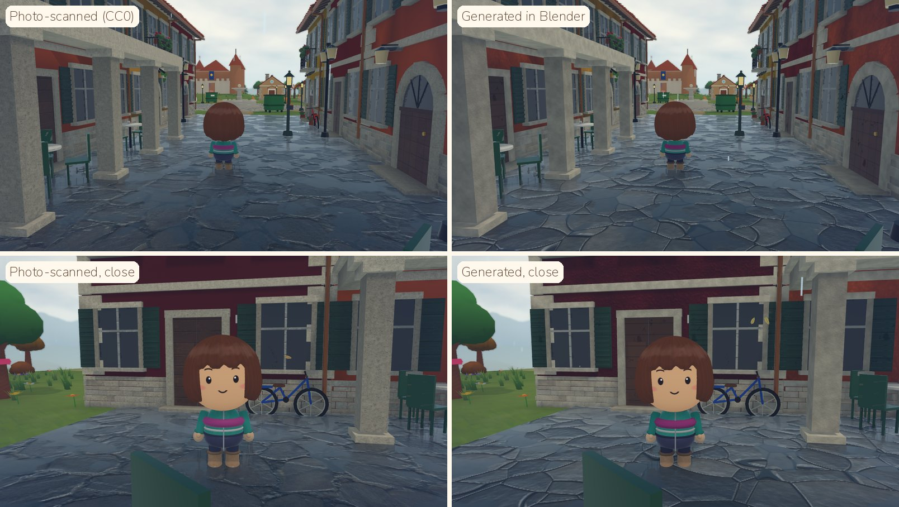

1. **Textures.**
   - **Photo-scanned (CC0):** the more natural look. Irregular flagstones, stone that reads as stone, and the closest
     to the paintover's realism. Plaster from a scan is subtle: on dark walls under cloud it almost disappears.
   - **Generated in Blender:** crisper and more designed, and fully original. The flagstones' cells and grout read a
     little computer-made, but the plaster blotches show more, and any material can be made on demand in the
     game's colours.
   - Both work with the same models and code. Mixing them works too, for example scans for stone and ground and
     generated plaster and painted wood.

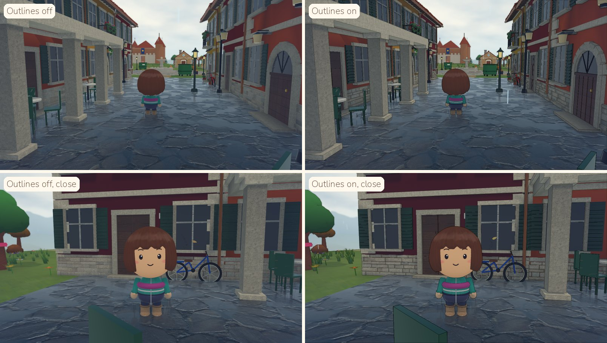

2. **Outlines.** With real materials, the ink lines make the frame read as an illustration again and add dark edges
   on wet stone. Off matches the paintover. The chibis still read well without them.

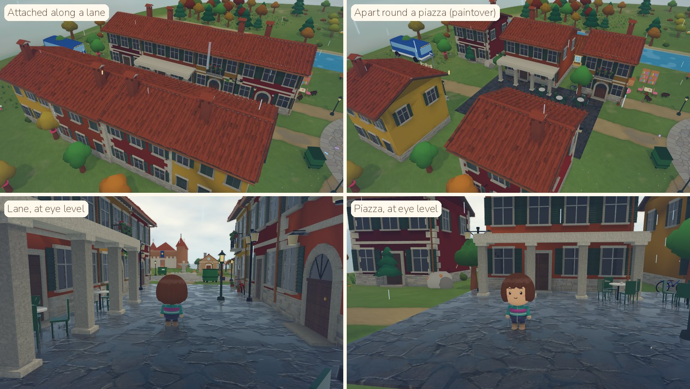

3. **Layout.**
   - **Attached along a lane:** reads as a real Langhe village street, enclosed and intimate, but hides the
     landscape.
   - **Apart round a piazza, as in the paintover:** open and airy, a toy village on a table, with more room for
     building and an easier camera.
   - Real Langhe villages do both: a dense core of attached houses along the lanes, opening onto a piazza, with
     houses standing apart at the edge, where the village meets the fields.

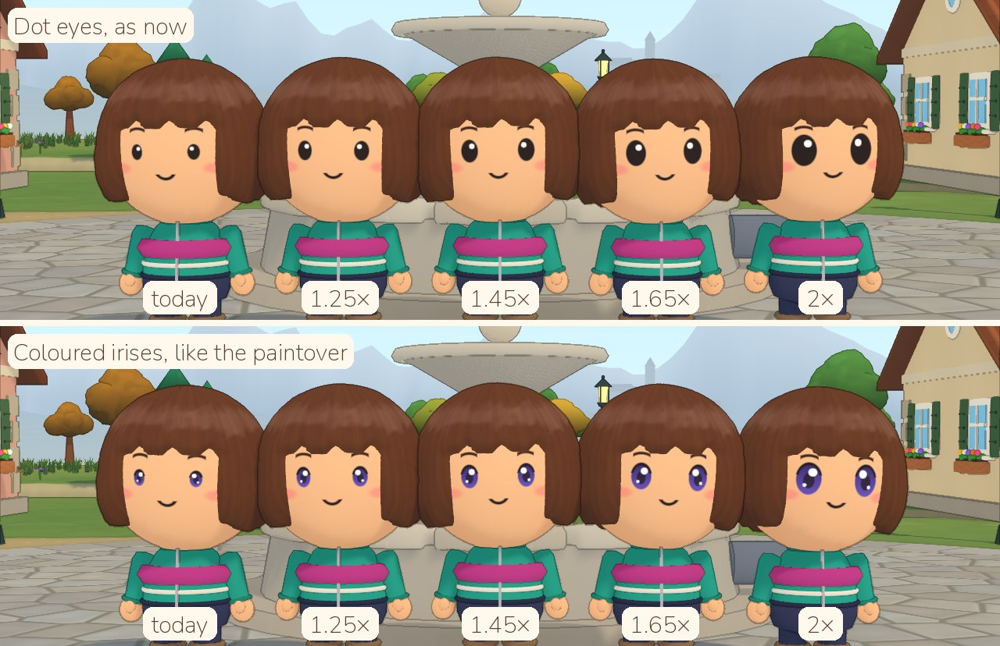

4. **Eyes.** Today's dots are 1×; the paintover's eyes are about 2×. Between them, 1.45× and 1.65× keep the face
   cute without taking it over. Coloured irises read better from about 1.45× up.

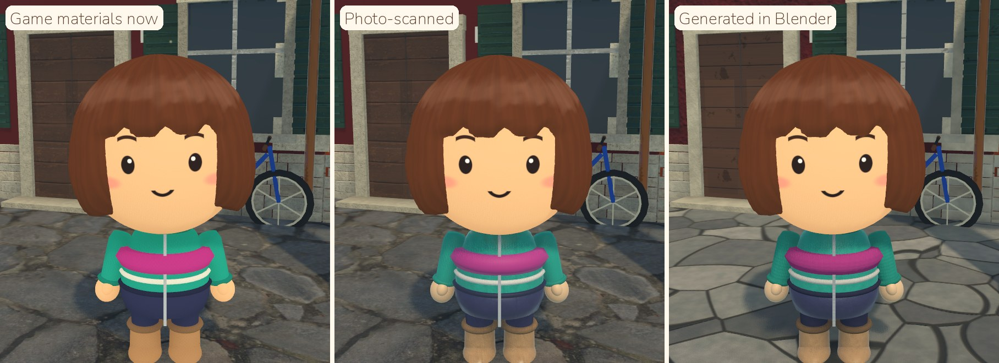

5. **Characters.** Real fabrics on today's chibis make a small difference: a softer jacket, sheen on the boots and
   hands. The chibis' shapes are smooth and simple, so the paintover's chunky knit and curly hair would also need
   new shapes, not just materials.

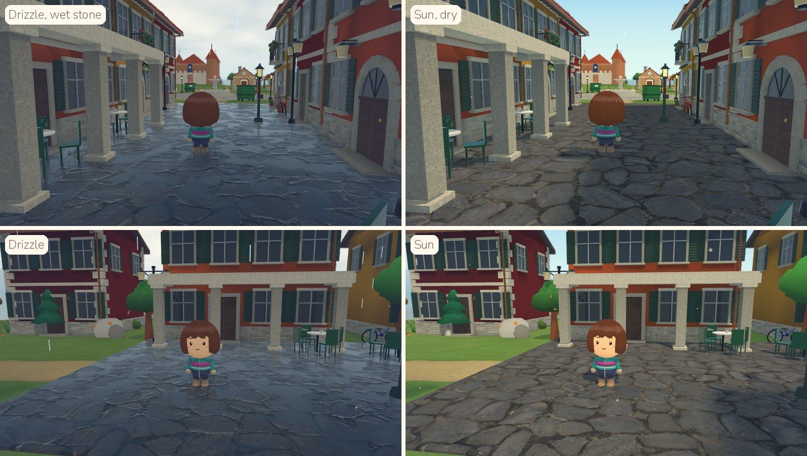

6. **Weather.** Wet stone with puddles that really reflect gives the paintover's mood. In sun, the same street is
   bright and cheerful. The look works in both.

**Converting the game would mean:**
- moving `Palette`'s materials and the terrain shaders to physically based shading;
- a texture pipeline;
- outlines off;
- reflections in the game's environment;
- the houses and layout above.

Because another agent is changing the graphics now, that starts with a new analysis of the game's state.

### Decisions after the look tests (07/11)
- **Textures: a mix, chosen material by material.** Generated in Blender for the flagstones (they clearly look better),
  the plaster, the knit and the denim. Photo-scanned for the stone (the columns look better with the real texture),
  the painted wood, the clay, the leather and the wool. The lab's `--labtex=mix` (`ModelKit.MIX`) uses this.
- **Outlines stay on.** They take away a lot of the blurry look, which doesn't fit with realistic textures.
- **Layout: attached houses for local flavour, but not every house.** Groups of attached houses of different heights,
  colours and setbacks, broken by alleys and garden gaps, with houses standing apart at the edges, so the village
  doesn't blend together. `tests/model_lab_village_mix.json` is a lane laid out that way, mixing both house
  families.
- **Eyes at 1.45× today's dots.** This is in the game now (`Chibi.EYE_SIZE`): every eye shape is between 1.45× and
  1.55×, because the wide eyes already were 1.55×.

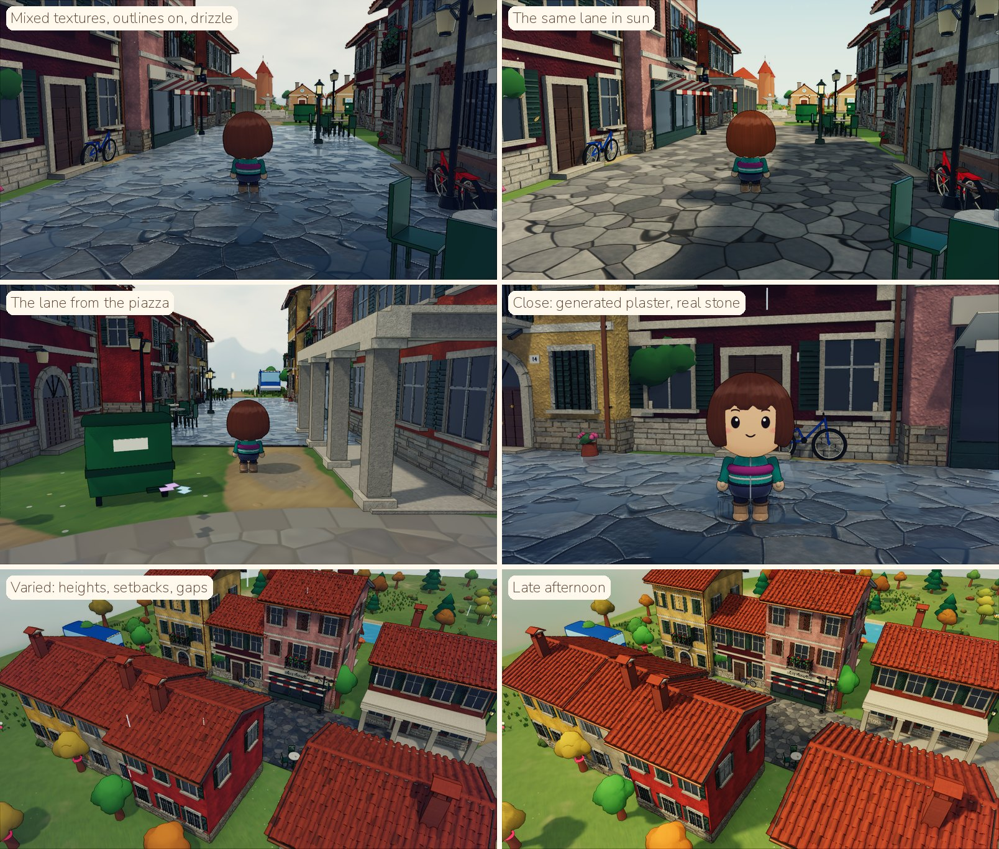

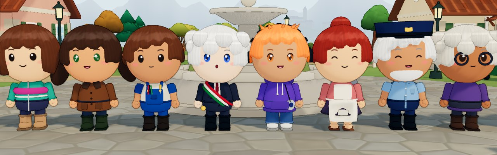

## How to run it
- **Get Blender:** the 4.2 LTS Linux build from download.blender.org (`Blender4.2/blender-4.2.3-linux-x64.tar.xz`),
  unpacked in a scratch folder outside the repo.
- **Rebuild the models:** `BLENDER=/path/to/blender tools/blender/build_lab.sh` (add `--blend <dir>` to keep the
  `.blend` files). Or run one script: `blender -b --factory-startup -P tools/blender/langhe_lane.py -- --out
  godot/assets/models/lab --only casa_ocra`.
- **Conventions** (`tools/blender/kit.py`):
  - metres, Blender Z up, front facing Blender -Y (Godot +Z), origin in the middle of the footprint on the ground;
  - materials named `wh_<kind>_<rrggbb>`;
  - the colour attribute `Col` multiplies the colour (baked AO, colour variation, damp at the foot of the walls).
- **Screenshots:** `--models` places the lab files' models, `--nohud` hides the interface:
  `./shot.sh out.png --skiptitle --nohud --models=res://tests/model_lab.json --pos=-31,3.8,1.57 --cam=-1.45,0.14,8 --time=10`.
  Add `res://tests/model_lab_sindaco.json` after a comma for the Sindacos. Use `RENDERER=forward_plus`. Leave
  `--models` out for the same view without the models.
- **The look tests:**
  - **models:** `blender -b --factory-startup -P tools/blender/toy_village.py -- --out godot/assets/models/lab`;
  - **photo-scanned textures:** `python3 tools/textures/fetch_polyhaven.py` (needs Pillow; set `SSL_CERT_FILE` behind
    a proxy);
  - **generated textures:** `blender -b --factory-startup -P tools/blender/make_textures.py -- --out
    godot/assets/textures/lab/blender`;
  - **screenshots:** `--models=res://tests/model_lab_toy_dense.json` (or `_spaced`). `--labtex=cc0|blender|mix` picks
    the texture set, `--labwet=0` makes it dry, `--labnpcs` keeps the villagers in shot, and `--outline=0|1`
    switches the ink lines. For example: `RENDERER=forward_plus ./shot.sh out.png --skiptitle --nohud --outline=0
    --weather=drizzle --models=res://tests/model_lab_toy_dense.json --pos=-25,3.4,1.57 --cam=-1.45,0.12,6.5
    --time=11`.
- **Tests:** `tests/test_models.gd` checks every lab model loads with only `wh_` materials, stands on the ground,
  is centred on its footprint and fits its triangle budget, and that the Sindaco has his skeleton and animations.
